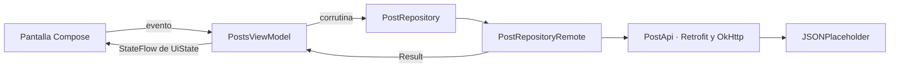
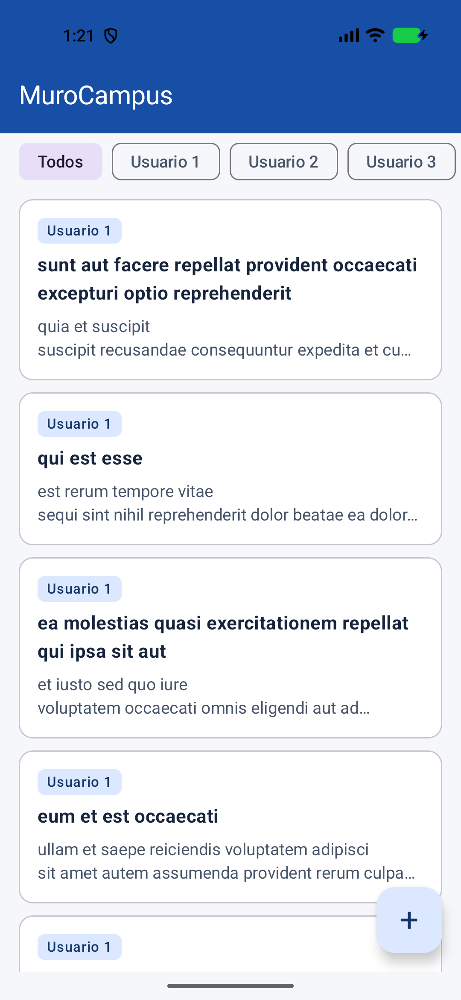
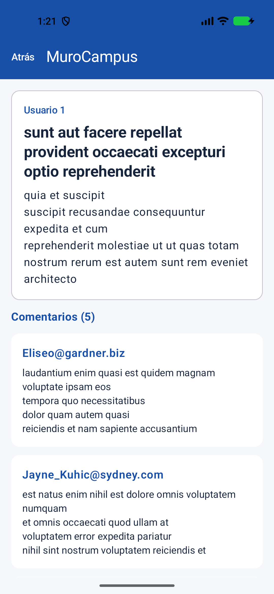
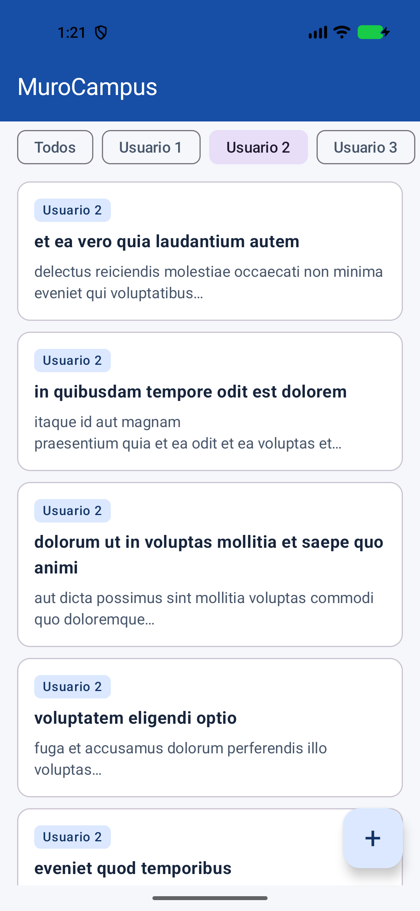
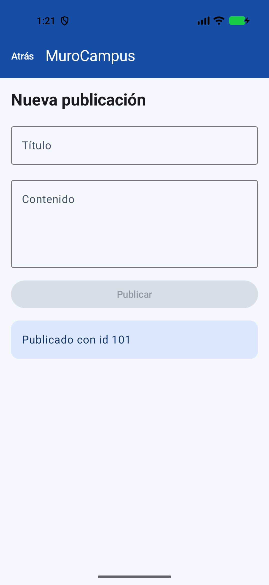
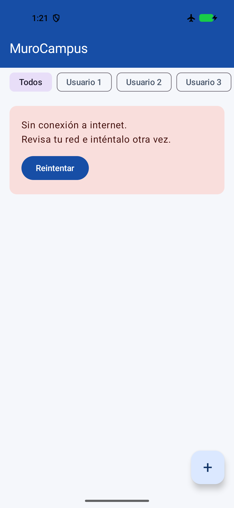

# MuroCampus

Aplicación Android del laboratorio 09 de Programación en Móviles. Permite leer el muro de JSONPlaceholder, abrir publicaciones con sus comentarios, filtrar por autor y enviar una publicación de prueba.

## Ejecutar en Android Studio

Abre la carpeta que contiene `settings.gradle.kts`. Usa JDK 17 o 21 para Gradle, instala Android SDK 35, sincroniza el proyecto y ejecuta **app** en un dispositivo con Android 7.0 (API 24) o superior. Se necesita conexión para consultar el servicio. En Windows también puedes compilar con `.\gradlew.bat assembleDebug`.

## Paquetes

```text
com.tecsup.murocampus/
├── MainActivity.kt                  Navegación y creación del ViewModel
├── model/Modelos.kt                 Usuario, Post, Comentario y NuevoPost
├── data/
│   ├── UsuarioRepository.kt         Ejemplo de usuarios
│   ├── PostRepository.kt            Contrato, implementación remota y errores
│   └── remote/
│       ├── PostApi.kt               Rutas y verbos HTTP
│       └── RetrofitClient.kt        Cliente y conversor JSON compartidos
├── viewmodel/
│   ├── PostsViewModel.kt            Lista, filtro, detalle y envío
│   ├── PostsViewModelFactory.kt      Inyección del repositorio
│   └── UiState.kt                   Cargando, Exito y Error
└── ui/
    ├── Componentes.kt               Tarjeta, carga y reintento
    ├── PantallaLista.kt
    ├── PantallaDetalle.kt
    ├── PantallaCrear.kt
    └── theme/Tema.kt
```

## Recorrido de una petición



Al tocar una tarjeta, la pantalla entrega el id al ViewModel. El repositorio obtiene la publicación y sus comentarios. Si cualquiera de las dos peticiones falla, el detalle ofrece un reintento. Al salir del detalle se cancela su corrutina. La lista conserva los datos en el ViewModel al rotar el dispositivo.

## Capturas del emulador

| Muro | Detalle y comentarios | Filtro por usuario |
| --- | --- | --- |
|  |  |  |

| Creación confirmada | Error de conexión |
| --- | --- |
|  |  |

## Pruebas de la fase 1

| Acción | Resultado observado |
| --- | --- |
| Abrir el muro en el emulador | Logcat registró «Llegaron 100 publicaciones» en la prueba temporal del cliente. |
| Consultar los usuarios 1 a 10 | Cada consulta devolvió 10 publicaciones con el identificador de autor elegido. |
| Abrir las publicaciones 1, 15 y 90 | Cada detalle devolvió 5 comentarios de esa publicación. |
| Enviar el formulario | Publicar empezó deshabilitado. Con ambos campos completos, el servicio devolvió HTTP 201 e id 101. Los campos se limpiaron. |
| Abrir en modo avión y después recuperar la conexión | La lista mostró «Sin conexión a internet». Reintentar recuperó el muro. El detalle también se recuperó con su propio botón. |
| Rotar el muro y volver rápidamente desde un detalle | La rotación conservó la lista y el regreso permitió abrir de nuevo la publicación. |
| Solicitar el detalle 9999 | El repositorio devolvió un fallo que se presentó como «Error del servidor (404)». |
| Decodificar un post con un campo adicional o sin un campo obligatorio | El conversor aceptó el campo adicional. La ausencia de body produjo «Respuesta inesperada». |

Las comprobaciones temporales se ejecutaron fuera del código de entrega. La base se reconstruyó a partir del contrato del PDF. Se utilizó Codex con la autorización de IA indicada por el estudiante.

## Para pensar

1. **¿Qué diferencia hay entre GET y POST?** GET consulta un recurso. POST envía datos para que el servidor los procese y, en este caso, cree una publicación. `@Body` serializa título, contenido y autor dentro de la petición. `@Query("userId")` agrega el filtro a la URL, por ejemplo `posts?userId=2`. En el detalle, `@Path("id")` sustituye un segmento de la ruta.
2. **¿Por qué escribir `posts` sin barra inicial?** Retrofit resuelve esa ruta respecto a la URL base. Con una base que termine en `/api/`, `posts` conserva el prefijo y produce `/api/posts`. Una barra inicial lleva a `/posts` desde la raíz del dominio.
3. **¿Por qué devolver Result?** El contrato hace explícitos éxito y fallo. El ViewModel puede actualizar el estado con el mismo flujo aunque cambie la fuente de datos. El repositorio relanza `CancellationException` para respetar el ciclo de vida de la corrutina.
4. **¿Qué pasa con el permiso y los campos desconocidos?** Android bloquea el acceso a la red si falta `INTERNET`. Con la configuración estricta predeterminada, un campo JSON nuevo puede romper la deserialización. `ignoreUnknownKeys = true` permite campos adicionales, pero un campo obligatorio ausente sigue siendo un error.
5. **¿Por qué usar when sobre UiState?** Cada instante tiene un único estado. Un `when` exhaustivo obliga a representar cada caso. Tres variables independientes permitirían combinaciones ambiguas, como indicar éxito y error al mismo tiempo.
6. **¿Qué cambiaría con un servicio real?** Tras un POST confirmado, incorporaría el objeto que devolvió el servidor al muro o recargaría la lista. El id definitivo serviría para abrir, editar o borrar el recurso en sesiones posteriores. JSONPlaceholder simula la creación y al recargar devuelve su conjunto original.
