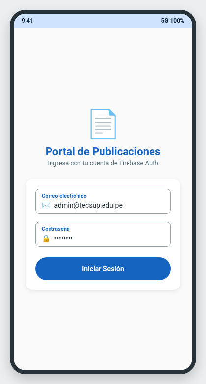
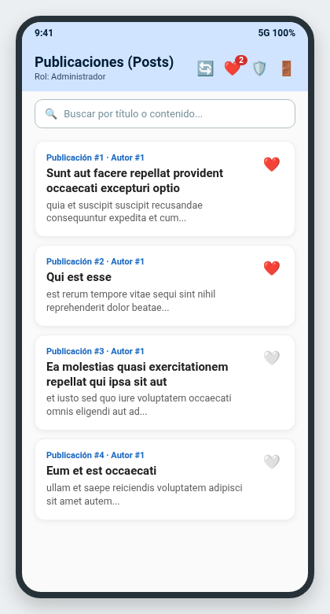
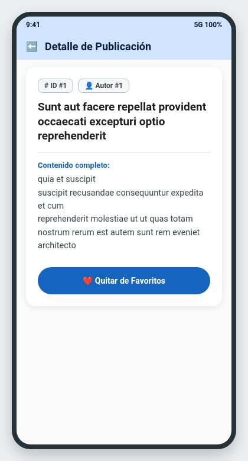
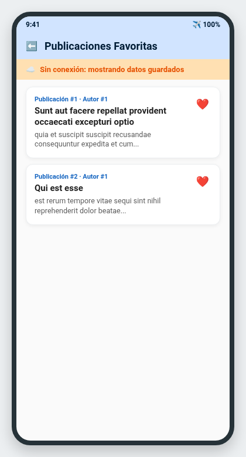
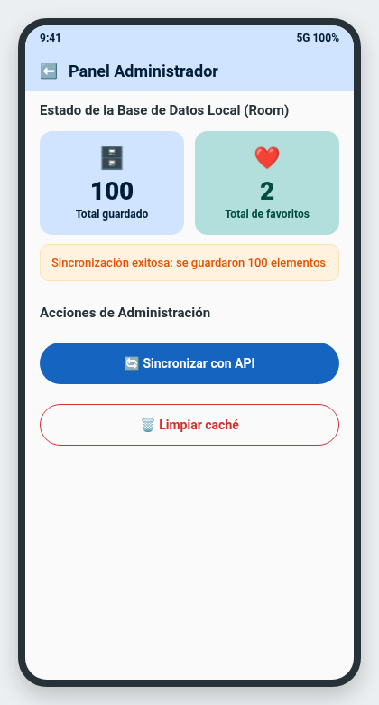
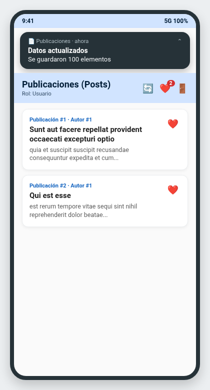

# Laboratorio 11-12: Compose + MVVM + Retrofit + Room + Firebase Auth

**Curso:** Programación en Móviles (4to Ciclo)  
**Docente:** Juan José León Suiyon  
**Tema:** Publicaciones (`https://jsonplaceholder.typicode.com/`)  
**Variante:** Recurso `posts` (`/posts` y `/posts/{id}`)  
**Paquete:** `com.tecsup.publicaciones`  
**Configuración de compilación:** Gradle `9.5.0` · Java `24.0.2` (`JavaVersion.VERSION_24`)

---

## 📁 Estructura del Laboratorio (`semana12/`)

- **[`Sin_IA/`](./Sin_IA)**: Fase 1 del proyecto (implementación completa de la arquitectura MVVM, Retrofit, Room, Firebase Auth + Firestore, Favoritos, Modo sin conexión, Panel Admin y Notificaciones locales).
- **[`Con_IA/`](./Con_IA)**: Fase 2 del proyecto con mejoras asistidas por IA (buscador reactivo en tiempo real con `combine`, badge de contador de favoritos en `TopAppBar`, 4 pruebas unitarias en `ListaViewModelTest.kt` con repositorio y notificador falsos, y el registro completo en [`PROMPTS.md`](./Con_IA/PROMPTS.md)).

---

## 🏗️ Arquitectura y Estructura de Paquetes (`com.tecsup.publicaciones`)

```text
app/src/main/java/com/tecsup/publicaciones/
├── MainActivity.kt
├── AppContainer.kt               ← crea API, base de datos y repositorios
├── data/
│   ├── remote/
│   │   ├── ApiService.kt         ← interface Retrofit (@GET("posts") y @GET("posts/{id}"))
│   │   ├── RetrofitClient.kt     ← cliente Retrofit con baseUrl terminada en /
│   │   └── dto/ItemDto.kt        ← DTO serializable de JSONPlaceholder
│   ├── local/
│   │   ├── ItemEntity.kt         ← tabla de Room ("items")
│   │   ├── ItemDao.kt            ← consultas Flow, Upsert y favoritos
│   │   └── AppDatabase.kt        ← instancia RoomDatabase
│   ├── auth/
│   │   ├── AuthRepository.kt     ← interface de autenticación
│   │   └── FirebaseAuthRepository.kt ← Firebase Auth + Firestore (colección usuarios/{uid})
│   ├── repository/
│   │   ├── ItemRepository.kt     ← interface del repositorio
│   │   └── ItemRepositoryImpl.kt ← Room como fuente única de verdad + Retrofit
│   └── mapper/Mappers.kt         ← conversión ItemDto → ItemEntity → Item
├── domain/model/
│   ├── Item.kt                   ← modelo de dominio que consume la UI
│   └── Sesion.kt                 ← Sesion + enum class Rol { ADMIN, USUARIO }
├── notification/
│   ├── Notificador.kt            ← interface sin dependencia de Android en el ViewModel
│   └── NotificadorAndroid.kt     ← NotificationCompat + canal + POST_NOTIFICATIONS
└── ui/
    ├── navigation/AppNav.kt
    ├── UiState.kt                ← sealed interface (Cargando, Exito, Error)
    ├── login/     LoginScreen.kt · LoginViewModel.kt
    ├── lista/     ListaScreen.kt · ListaViewModel.kt
    ├── detalle/   DetalleScreen.kt · DetalleViewModel.kt
    ├── favoritos/ FavoritosScreen.kt · FavoritosViewModel.kt
    ├── admin/     AdminScreen.kt · AdminViewModel.kt
    ├── components/ Cargando.kt · ErrorView.kt
    └── theme/     Color.kt · Theme.kt · Type.kt
```

---

## ☁️ Configuración del Proyecto en Firebase / Google Cloud

1. Ingresar a [Firebase Console](https://console.firebase.google.com/) y crear un nuevo proyecto.
2. Registrar una aplicación Android con el nombre de paquete exacto:
   ```text
   com.tecsup.publicaciones
   ```
3. Descargar el archivo `google-services.json` y colocarlo dentro de la carpeta `app/` de tu proyecto en Android Studio (`semana12/Sin_IA/app/google-services.json` y `semana12/Con_IA/app/google-services.json`). *(Por seguridad y según las reglas del laboratorio, `google-services.json` está incluido en `.gitignore` para no exponer claves de API en el repositorio público).*
4. En **Authentication → Sign-in method**, habilitar el proveedor **Correo electrónico/contraseña**.
5. En **Authentication → Usuarios**, crear los dos usuarios de prueba:
   - `admin@tecsup.edu.pe` (copiar su **UID** generado)
   - `usuario@tecsup.edu.pe` (copiar su **UID** generado)
6. En **Firestore Database**, crear la base de datos y la colección `usuarios` con dos documentos cuyo **ID de documento** sea exactamente el **UID** de cada usuario:
   - Documento `<UID_ADMIN>`: campos `rol: "admin"` y `nombre: "Administrador"`
   - Documento `<UID_USUARIO>`: campos `rol: "usuario"` y `nombre: "Usuario"`
7. En **Firestore Database → Reglas**, publicar las reglas de seguridad del laboratorio:
   ```javascript
   rules_version = '2';
   service cloud.firestore {
     match /databases/{database}/documents {
       match /usuarios/{uid} {
         allow read: if request.auth != null && request.auth.uid == uid;
         allow write: if false;
       }
     }
   }
   ```

---

## 💡 Preguntas de Observación y Sustentación

### 1. ¿Por qué el `Repository` (`ItemRepository` / `AuthRepository`) es una `interface`? ¿Qué cambiaría si no lo fuera?
> **Respuesta:**  
> Declarar el repositorio como una `interface` aplica el principio de **Inversión de Dependencias (DIP)**: el `ViewModel` depende de un contrato abstracto (`ItemRepository`) y no de detalles de implementación (`Retrofit`, `Room` o `Firebase`). Si fuera una clase concreta acoplada a `ApiService` y `ItemDao`, no podríamos inyectar un `FakeItemRepository` en memoria durante las pruebas unitarias (`ListaViewModelTest`), obligándonos a levantar una base de datos real o realizar llamadas de red en cada test. Además, permite cambiar la fuente de datos sin modificar ni una línea en los ViewModels ni en las pantallas Compose.

### 2. ¿Por qué la lista sale de `Room` (`Flow<List<Item>>`) y no directamente de `Retrofit`?
> **Respuesta:**  
> Porque **Room actúa como la única fuente de verdad (*Single Source of Truth*)**. La interfaz de usuario observa continuamente `dao.todos()` mediante un `Flow`. Cuando `Retrofit` descarga datos desde `https://jsonplaceholder.typicode.com/posts`, únicamente actualiza la tabla local de `Room` (`dao.guardarTodos(nuevos)`), y `Room` emite automáticamente la lista actualizada a la UI. Esto garantiza que la aplicación funcione **sin conexión a internet (modo offline)** mostrando los datos guardados en el dispositivo y que los cambios locales (como marcar o desmarcar un favorito) se reflejen de inmediato en todas las pantallas.

### 3. ¿Qué pasa con los favoritos cuando sincronizas? ¿Cómo se conservan en el código?
> **Respuesta:**  
> Si insertáramos directamente los datos de la API con `@Upsert`, el campo `esFavorito` se sobrescribiría a `false` porque la API remota no conoce qué elementos marcó el usuario en su teléfono. Para conservarlos, antes de guardar los nuevos registros en `ItemRepositoryImpl.refrescar()`, primero consultamos los IDs favoritos actuales en Room (`val favoritos = dao.idsFavoritos().toSet()`) y al mapear cada `ItemDto` a `ItemEntity` reaplicamos su estado (`it.aEntity(esFavorito = it.id in favoritos)`). De este modo, el `@Upsert` actualiza títulos y contenidos pero preserva intactos los favoritos del usuario.

### 4. ¿Dónde se decide el rol de la persona (`ADMIN` o `USUARIO`) y por qué no en la pantalla?
> **Respuesta:**  
> El rol no se decide ni se elige en la pantalla de la aplicación; se almacena en **Cloud Firestore** dentro del documento `usuarios/{uid}` (campo `rol`) y es leído por `FirebaseAuthRepository.leerSesion()` inmediatamente después de autenticar al usuario con `FirebaseAuth`. Decidir el rol en la interfaz sería inseguro porque cualquier usuario podría elegir entrar como administrador; además, las reglas de seguridad de Firestore (`request.auth != null && request.auth.uid == uid` y `allow write: if false`) impiden que un usuario modifique su propio rol desde el cliente.

### 5. ¿Qué ocurre si el permiso de notificaciones (`POST_NOTIFICATIONS`) está negado?
> **Respuesta:**  
> En Android 13+ (API 33+), `NotificadorAndroid.mostrar()` verifica primero si el permiso `Manifest.permission.POST_NOTIFICATIONS` fue concedido mediante `ContextCompat.checkSelfPermission(...)`. Si el usuario negó el permiso, el método retorna silenciosamente sin lanzar excepciones (`SecurityException`), permitiendo que la sincronización, la base de datos Room y todas las pantallas de la aplicación continúen funcionando con total normalidad (cumpliendo la prueba de aceptación **PA-14**).

---

## ✅ Lista de Verificación de Pruebas de Aceptación (PA-01 a PA-14)

| Código | Caso de Prueba | Resultado |
| :--- | :--- | :---: |
| **PA-01** | Ingresar con el usuario `usuario` | Entra al catálogo. No muestra el ícono del Panel Admin. |
| **PA-02** | Ingresar con el usuario `admin` | Entra al catálogo y muestra el acceso al Panel Admin en la barra superior. |
| **PA-03** | Contraseña incorrecta | Muestra mensaje de error claro y no permite el ingreso. |
| **PA-04** | Dejar correo o clave vacíos | Muestra validación local inmediata sin llamar a Firebase. |
| **PA-05** | Primera apertura con internet | Muestra `Cargando`, luego la lista de publicaciones y la notificación `«Se guardaron 100 elementos»`. |
| **PA-06** | Tocar un elemento | Navega a `DetalleScreen` consumiendo el segundo endpoint (`GET /posts/{id}`). |
| **PA-07** | Marcar un favorito y cerrar la app | Persiste en SQLite (`Room`) y al reabrir sigue en la pantalla `Favoritos`. |
| **PA-08** | Modo avión con datos guardados | Muestra las publicaciones guardadas y el banner `"Sin conexión: mostrando datos guardados"`. |
| **PA-09** | Modo avión sin datos (app recién instalada) | Muestra `ErrorView` con el mensaje `"No hay conexión a internet"` y el botón **Reintentar**. |
| **PA-10** | Sincronizar después de marcar un favorito | Conserva el estado `esFavorito = true` gracias a `dao.idsFavoritos()`. |
| **PA-11** | Admin pulsa Limpiar caché | Borra los registros de Room (`total = 0`) y al pulsar Sincronizar se descargan nuevamente. |
| **PA-12** | Cerrar sesión y reabrir la app | Ejecuta `auth.signOut()`, limpia el backstack y solicita credenciales en `LoginScreen`. |
| **PA-13** | Girar la pantalla | Conserva el estado en los `ViewModel` (`StateFlow`) y `rememberSaveable` sin volver a descargar. |
| **PA-14** | Negar el permiso de notificaciones | La app funciona con normalidad sin cerrarse ni mostrar errores. |

---

## 📸 Capturas de Pantalla de la Aplicación

| 1. Login con Firebase Auth | 2. Catálogo y Buscador | 3. Detalle de Publicación |
| :---: | :---: | :---: |
|  |  |  |

| 4. Favoritos y Modo Sin Conexión | 5. Panel Administrador | 6. Notificación Local |
| :---: | :---: | :---: |
|  |  |  |

