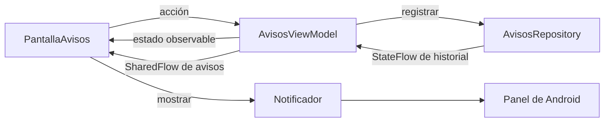
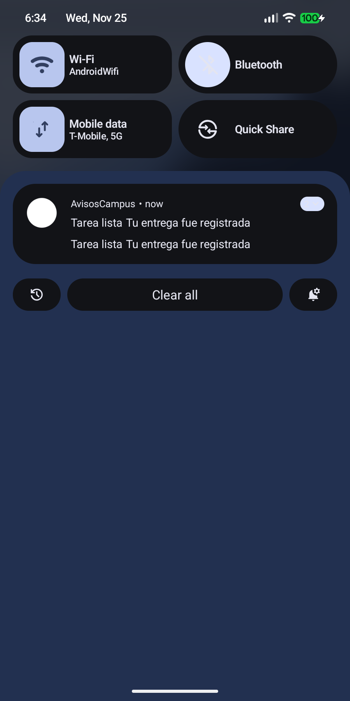
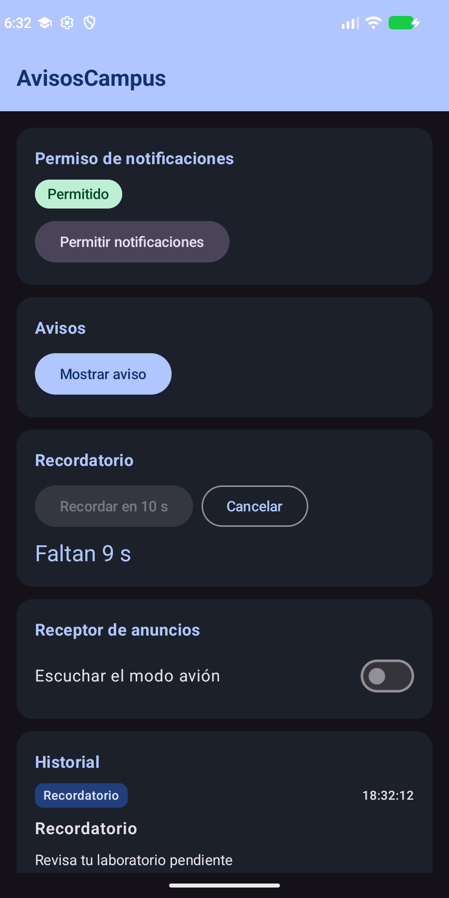
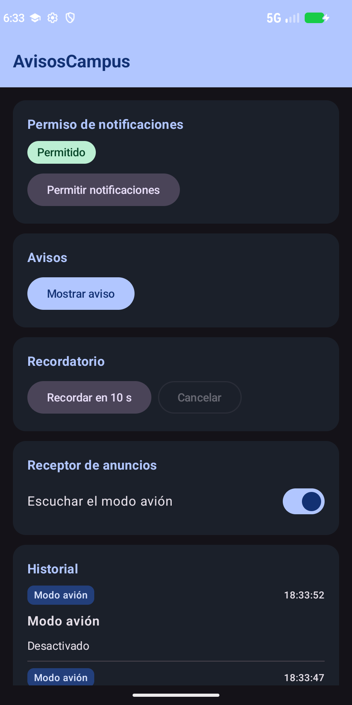
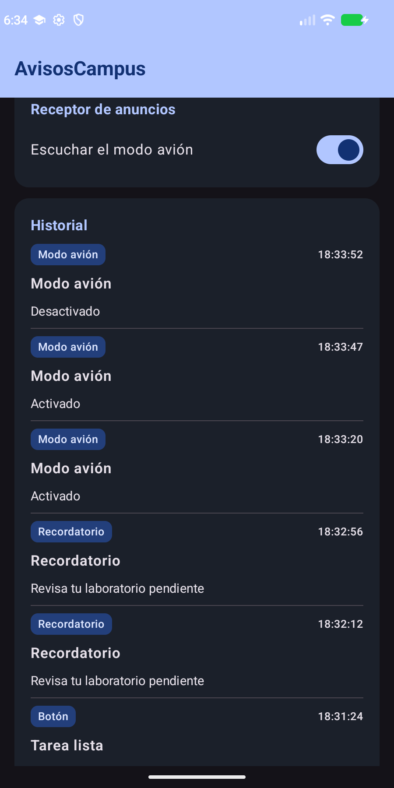
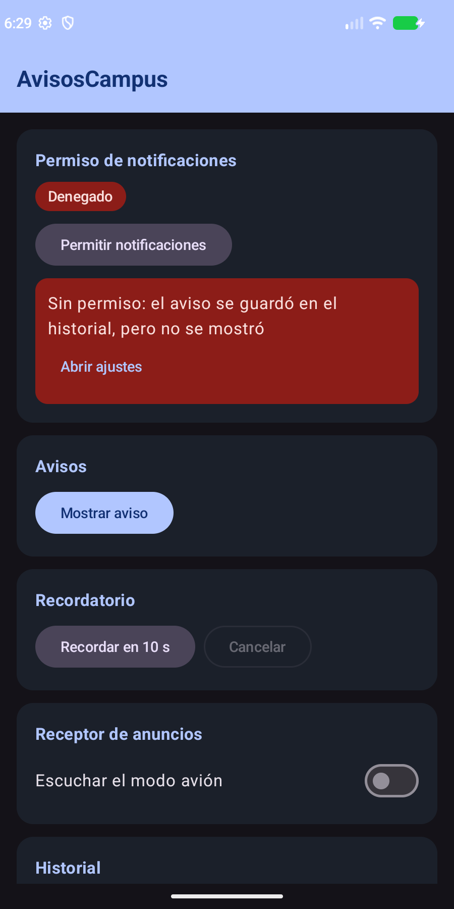

# AvisosCampus

Laboratorio 15 de Programación en Móviles. La aplicación registra avisos ficticios del campus y los envía al panel de Android. Permite programar un recordatorio de 10 segundos, cancelarlo y escuchar cambios de modo avión. Las cinco tarjetas comparten una sola pantalla desplazable.

## Fase 2 · mejora-ia

| Mejora | Cómo comprobarla |
| --- | --- |
| Canal Urgentes | Programa el recordatorio y abre sus ajustes desde el panel. El recordatorio usa Urgentes con importancia alta. El botón y los receptores usan Avisos. Android decide la presentación según los ajustes del usuario. |
| Texto expandible | Genera un aviso y despliega su notificación. La vista compacta muestra el texto de la guía y la expandida añade el detalle. |
| Receptor del cargador | Activa **Escuchar el cargador** y conecta o desconecta la alimentación del dispositivo. En el emulador puedes cambiar el estado de carga en los controles de batería. Cada transición añade una fila con su hora. |

El registro de decisiones y una explicación de la mejora del cargador están en [PROMPTS.md](PROMPTS.md).

## Ejecutar

1. Abre la carpeta del repositorio en Android Studio y sincroniza Gradle.
2. Selecciona el módulo `app` y un dispositivo con Android 13 o superior para probar el diálogo de permiso. La aplicación admite Android 8 o superior.
3. Pulsa **Run**, toca **Permitir notificaciones** y después **Mostrar aviso**. Desliza desde el borde superior para ver **Tarea lista**.

La compilación usa el SDK 36. En Windows, `gradlew.bat assembleDebug` genera el APK de desarrollo. La app funciona localmente, sin cuentas, claves ni conexión a Internet.

## Estructura

```text
com.tecsup.avisoscampus/
├── AvisosApp.kt                       Crea el canal al iniciar
├── MainActivity.kt                    Monta Compose y obtiene el ViewModel
├── model/Modelos.kt                   Aviso, Origen y PermisoUi
├── data/AvisosRepository.kt           Contrato e implementación en memoria
├── notificacion/Notificador.kt        Permiso, canal, publicación y PendingIntent
├── receiver/
│   ├── ModoAvionReceiver.kt           Escucha cambios de modo avión
│   └── CargadorReceiver.kt            Escucha conexión y desconexión de alimentación
├── viewmodel/
│   ├── AvisosViewModel.kt             Decide y registra cada aviso
│   └── AvisosViewModelFactory.kt      Inyecta el repositorio
└── ui/
    ├── PantallaAvisos.kt              Permisos, acciones y registro del receptor
    ├── HistorialAvisos.kt             Presenta los 20 avisos más recientes
    └── theme/TemaCampus.kt            Colores para tema claro y oscuro
```

## Recorrido de un aviso



El repositorio ordena los avisos por creación. El ViewModel conserva el historial, el interruptor y el trabajo de la cuenta regresiva durante una rotación. El recordatorio continúa cuando se minimiza la actividad mientras el proceso sigue vivo. El historial reside en memoria y termina con el proceso.

## Capturas de la fase 1

| Panel de Android | Cuenta regresiva | Modo avión |
| --- | --- | --- |
|  |  |  |

| Historial por hora y origen | Permiso denegado |
| --- | --- |
|  |  |

## Para pensar

1. **¿Para qué sirven el canal y el permiso?** Desde Android 8, el canal agrupa avisos y permite ajustar su importancia. Android descarta las notificaciones que una app moderna publica sin un canal válido. Desde Android 13, el permiso permite al usuario decidir si la aplicación puede enviar avisos. Si lo deniega, AvisosCampus conserva la entrada en el historial y ofrece abrir Ajustes.
2. **¿Por qué emitir un evento desde el ViewModel?** El ViewModel decide el contenido del aviso y registra lo ocurrido. La pantalla recibe el evento e invoca al notificador con el contexto válido de Android. El historial sí se vuelve a mostrar al rotar. El evento de publicación se consume una vez para evitar duplicados.
3. **¿Qué ocurre al reutilizar un ID?** Una segunda publicación con el mismo ID y la misma etiqueta actualiza la notificación anterior de la app. El repositorio asigna un ID distinto a cada entrada para que varios avisos puedan coexistir.
4. **¿Por qué debe ser corto onReceive? ¿Por qué retirar el receptor?** Android ejecuta la devolución de llamada en el hilo principal en este registro. El receptor lee la acción y entrega el estado al ViewModel enseguida. Darlo de baja en `onDispose` evita conservar el contexto de una pantalla destruida y evita callbacks duplicados tras una rotación.
5. **¿Cuándo usarías local o push?** Una cuenta regresiva iniciada en el teléfono y un cambio de modo avión se conocen en el dispositivo, así que admiten notificaciones locales. Un cambio de aula publicado por el docente en un servidor requiere comunicar una novedad externa a los alumnos. Para ese caso usaría un mensaje push mediante Firebase Cloud Messaging.

## Origen y diseño

La base se reconstruyó desde cero a partir de los contratos y fragmentos de la guía, con asistencia de Codex en ambas fases. La rama `main` conserva un commit por paso. El diseño mantiene el orden del laboratorio y emplea botones, tarjetas, roles de color y estilos tipográficos de Material 3. El azul de campus y el ancho máximo del contenido son decisiones propias. [Referencia de Material 3 Expressive](https://github.com/abhixv/google-m3-expressive-design-skill)


## Pruebas de aceptación

Ejecutadas en un Pixel 8a emulado con API 37.

- [x] Canal Avisos registrado con importancia predeterminada.
- [x] Diálogo de permiso y cambio de la etiqueta de estado.
- [x] Aviso inmediato en el panel con título y texto.
- [x] Dos avisos con identificadores distintos.
- [x] Apertura de la actividad desde el panel y autocancelación del aviso tocado.
- [x] Cuenta regresiva y notificación al finalizar.
- [x] Entrega del recordatorio con la app minimizada.
- [x] Cancelación antes del vencimiento sin una notificación adicional.
- [x] Activación y desactivación del modo avión con la escucha habilitada.
- [x] Ausencia de avisos de modo avión al desactivar la escucha.
- [x] Permiso denegado, conservación en historial, apertura de Ajustes y recuperación.
- [x] Continuidad del recordatorio y de la escucha tras rotar.
- [x] Revisión del ViewModel y liberación del receptor en onDispose.
